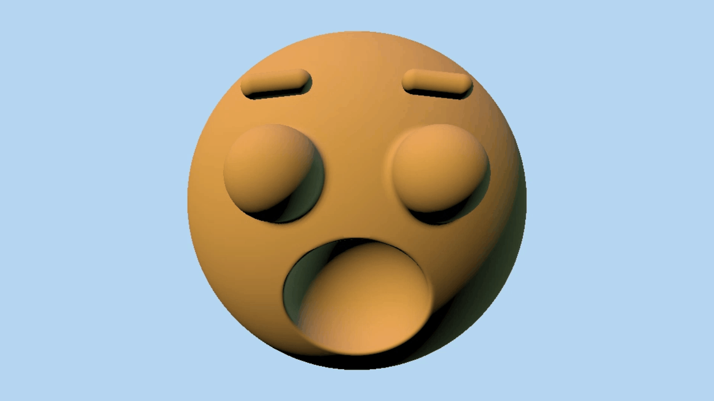

# Lab 08 - Procedural Face
The instructions for the lab can be found [here](https://github.com/CIS-5660-Fall-2026/lab08-face); my Shadertoy can be found [here](https://www.shadertoy.com/view/f3VSD1).

`SURPRISE` is accomplished by modulating based on time a size multiplier to achieve the shrinking and growing of the mouth and eyes. That same value is used to offset the eyebrow position.

For my custom parameter, I used a similar time-based modulation to modify the inner position of the eyebrows, achieving alternating "angry" and "shocked" expressions in my face.