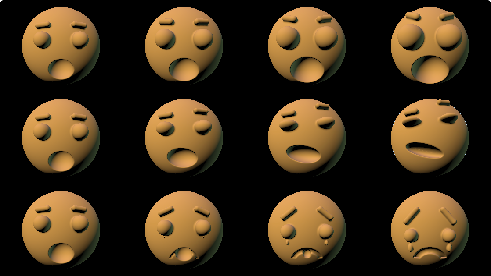

# Lab 08 - Procedural Face

Zhuoyang Pan, Yao Tang

Shadertoy: https://www.shadertoy.com/view/s3KXD1

The shader cycles through the three parameters, four seconds each. Set `ANIMATE` to 0 in the Image tab and edit the constants in `faceSDF` to drive them by hand. Image tab is also in [face.glsl](face.glsl).

Rows: SURPRISE, SMUGNESS, SADNESS. Columns: 0, 1/3, 2/3, 1.

## Task 1: SURPRISE

- Eyes grow and sit higher
- Brows lift and arch
- Mouth grows, drops and deepens into an O

## Task 2: SMUGNESS

Picked it because it's the one asymmetric expression.

- One brow cocked up, the other pressed down
- Eyes squash into a squint
- Mouth slides sideways and tilts into a smirk
- Chin up, slight head roll

## Extra credit: SADNESS

- Brows slant inward
- Eyes shrink and droop
- Mouth hole fades into a frown groove (the top arc of a ring centred below the mouth)
- Tears appear past 0.3 and slide down
- Head hangs forward

## Notes

- The base puts eyes and brows at a fixed z = 2.0, so lifted brows float off the sphere. `headZ(x, y)` returns the head surface depth and everything is placed relative to it.
- `ringOnHeadSDF` measures the frown groove's depth from the local head surface, so the arc stays carved in.
- Tears and the shrunken mouth are clamped to a tiny radius, since a zero-size ellipsoid divides by zero.
